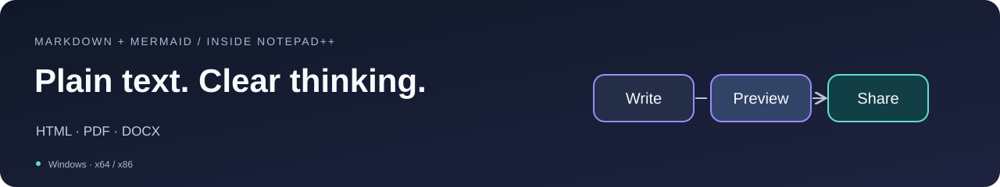
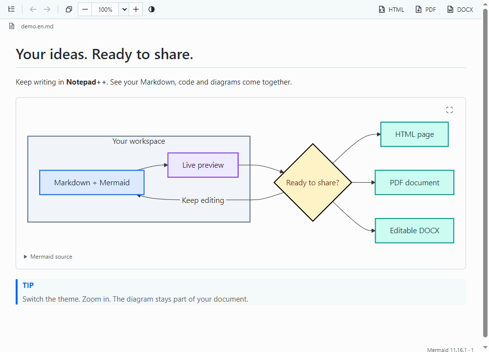
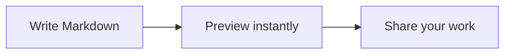

# Markdown with Mermaid

**Write in Notepad++. See the document. Share the result.**

Live Markdown preview, offline Mermaid diagrams, formatted copy and HTML / PDF / DOCX export — inside the editor you already use.



**[Download 1.4.1](https://github.com/rhyots/Markdown_with_Mermaid/releases/tag/v1.4.1)** · [Install](#installation) · [Features](#features) · [User guide](docs/USAGE.md) · [Русский](README.ru.md)

Windows · x64 & x86 · Mermaid included · No Office or Pandoc required

> **Version 1.4.1** — download the ZIP matching your Notepad++ architecture and follow the installation steps below. The plugin is not yet listed in Plugins Admin.



*Actual Preview rendering captured in the WebView2 integration host. This short sequence shows content updates, theme switching, zoom and selection. [Static screenshots and capture details](docs/screenshots/README.md).*

<!-- section:features -->
<a id="features"></a>
## Stay in your editor. Get more from Markdown.

| What you want to do | What the plugin gives you |
| --- | --- |
| **See what you are writing** | A live, dockable preview with tables, task lists, highlighted code, images and GitHub alerts. Unsaved edits appear too. |
| **Open Markdown and get to work** | Preview opens automatically for `.md` files. Auto-show and source-scroll synchronization are enabled on first use. |
| **Keep your place** | Preview follows the editor through long blocks and wrapped lines. Double-click Preview to bring the clicked source line to the top of both panes. |
| **Explain an idea visually** | Bundled **Mermaid 11.16.1** renders diagrams offline, with light/dark themes and readable labels, arrows and borders. |
| **Move through documentation** | Outline, local Markdown links, section links, Back/Forward and search keep large documents manageable. |
| **Hand over the result** | Copy formatted content or export HTML, PDF and editable DOCX — a whole document or just a selection. |

Zoom the document with **Ctrl+wheel** while the toolbar stays the same size. Resize or undock the panel; Notepad++ remembers its layout. Your saved preferences survive updates.

<!-- section:installation -->
<a id="installation"></a>
## Open your first preview

You need **Notepad++ 8.4.1 or later** and [Microsoft Edge WebView2 Runtime](https://developer.microsoft.com/microsoft-edge/webview2/). Choose the plugin architecture that matches **Notepad++**, even on a 64-bit Windows installation.

1. Download the **x64** or **x86** plugin ZIP from [Releases](https://github.com/rhyots/Markdown_with_Mermaid/releases). Choose the plugin package, rather than the source archive.
2. Save your documents and close Notepad++.
3. Create `plugins/Markdown_with_Mermaid` inside the Notepad++ installation folder. Extract the **contents** of the ZIP there, keeping its subfolders.
4. Start Notepad++ and open an `.md` file. Preview opens automatically on first use; **Ctrl+Alt+M** shows or hides it.

```text
Notepad++/
└── plugins/
    └── Markdown_with_Mermaid/
        ├── Markdown_with_Mermaid.dll
        ├── assets/
        ├── x64/  (or x86/)
        │   └── WebView2Loader.dll
        ├── licenses/
        └── docs/
```

Copying into Program Files may require administrator rights. Normal use does not. If you have used the plugin before, your saved Auto-show preference is retained. [Installation help, updates and removal](docs/USAGE.md).

<!-- section:example -->
<a id="example"></a>
## Try a diagram

Save this as an `.md` file and open it in Notepad++:

````markdown
# A small idea, made visible


````

Edit a label and watch the diagram update. Mermaid runs locally; the diagram needs no internet connection.

Start with the [complete demo](docs/screenshots/demo.en.md), or explore [flowcharts, sequences, ER diagrams, classes, Gantt and pie charts](docs/Mermaid-examples.md).

<!-- section:export -->
<a id="export"></a>
## From a working note to a finished document

| Action | What you get |
| --- | --- |
| **Copy** | Formatted text, lists, links, tables and images for applications that accept HTML. Mermaid diagrams become images. |
| **HTML** | A rendered page with embedded styles and static Mermaid SVG. Referenced images must remain available. |
| **PDF** | A light-themed A4 document, ready to print, including diagrams. No printer required. |
| **DOCX** | Editable headings, paragraphs, lists and tables, with Mermaid diagrams embedded as images. No Word installation required to export. |

**Only need one part?** Select it in Preview or the editor, then export. Clear selections in both panes to export everything. Export captures unsaved edits; PDF and DOCX use a light theme without changing your Preview.

Details: [copy and selection rules](docs/USAGE.md) · [PDF](docs/PDF-EXPORT.md) · [DOCX](docs/DOCX-EXPORT.md).

<!-- section:shortcuts -->
<a id="shortcuts"></a>
## Small controls that save time

| In Preview | Action |
| --- | --- |
| **Ctrl+Alt+M** | Show or hide the panel from Notepad++. |
| **Ctrl+wheel** / **Ctrl+0** | Zoom the document / return to actual size. |
| **Double-click content** | Jump to the matching source line, including lines inside long code blocks. |
| **Ctrl+F** | Find text in the preview. |
| **Ctrl+C** / **Copy** | Copy the selection with formatting, or the whole rendered document if nothing is selected. |
| **File icon beside the filename** | Copy the filename as plain text, with a brief confirmation. |
| **Theme button** | Switch Preview, code highlighting and diagrams between light and dark. |

With editor focus, **Ctrl+C** keeps the normal Markdown source-copy behavior. Scroll synchronization follows the editor; double-click is the explicit return from Preview to source.

<!-- section:compatibility -->
<a id="compatibility"></a>
## Compatibility at a glance

| Component | Support |
| --- | --- |
| Notepad++ | **8.4.1+**, x64 and x86. Native functional acceptance on **8.9.8.1**; minimum-version startup/API/runtime smoke on **8.4.1**. |
| Windows | Tested on **Windows 10**. Windows 11 is a target, not yet independently tested. |
| Rendering | Microsoft Edge WebView2 Runtime; Mermaid and other preview assets are included. |
| Export dependencies | No Office, LibreOffice, Pandoc, Node.js, .NET or separate Visual C++ Redistributable needed. |
| Distribution | Release ZIPs. No ARM64 package; the plugin DLLs are unsigned. Public Plugins Admin listing is pending. |

Local Markdown and Mermaid work offline. External images and links can use the network. Page settings for PDF/DOCX are fixed; math typesetting and external Mermaid layout plugins are not included. [Validation details](docs/TESTING.md) · [Data and privacy](docs/DATA-PRIVACY.md) · [Limits](docs/USAGE.md).

<!-- section:documentation -->
<a id="documentation"></a>
## Go a little further

| Guide | Read it for |
| --- | --- |
| [User guide](docs/USAGE.md) | Navigation, copy, exports, preferences and troubleshooting. |
| [Mermaid examples](docs/Mermaid-examples.md) | Copyable examples of several diagram types. |
| [Changelog](CHANGELOG.md) | What changed between releases. |
| [Build](docs/BUILDING.md) · [Test](docs/TESTING.md) | Reproduce the build and understand validation coverage. |

<!-- section:support -->
<a id="support"></a>
## Help make it better

Found a problem? [Open an issue](https://github.com/rhyots/Markdown_with_Mermaid/issues) with your Notepad++ version and architecture, Windows version, and a small Markdown example. A screenshot helps with layout issues.

Made by [Artyom Nikiforov (rhyots)](https://github.com/rhyots) · [Licensing](docs/LICENSING.md).
