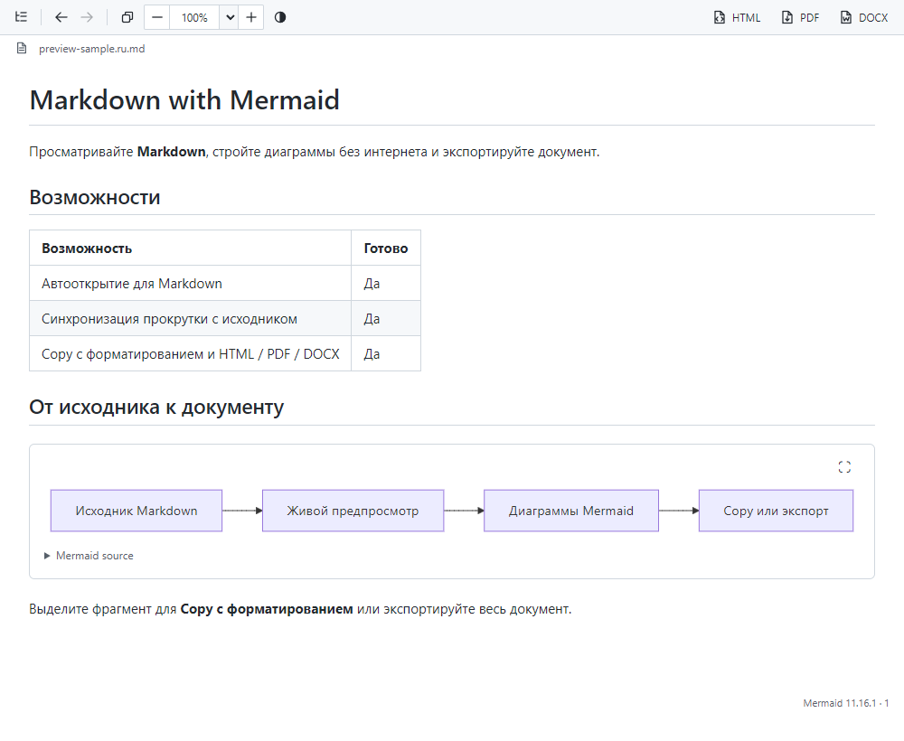
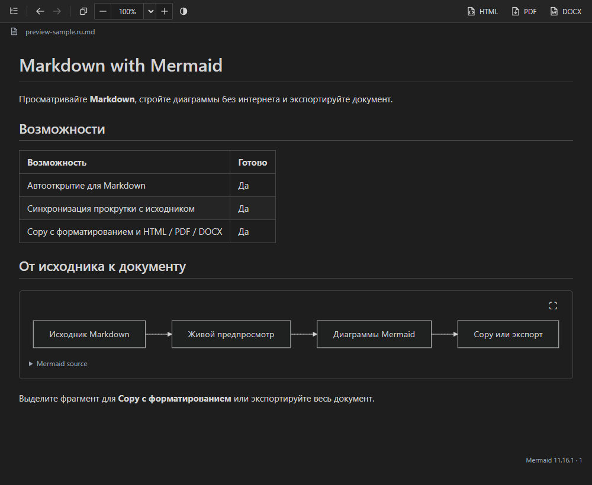

# Markdown_with_Mermaid

[English documentation](README.md)

Предпросмотр Markdown для Notepad++ с **отображением по подобию VS Code**,
автономным **Mermaid 11.16.1**, копированием с форматированием и встроенным
экспортом HTML, PDF и DOCX. Нативный плагин Windows для **x64 и x86**.

Автор: [Artyom Nikiforov (rhyots)](https://github.com/rhyots).
**1.4.0 — кандидат релиза; бинарные пакеты ещё не опубликованы.** Приёмка
в настоящем Notepad++ продолжается: [состояние проверок](docs/TESTING.md).

<!-- section:advantages -->
## Возможности

- **Привычный предпросмотр:** markdown-it и оформление, адаптированное из VS Code,
  с таблицами, задачами, подсветкой кода, якорями заголовков и GitHub alerts.
- **Диаграммы без интернета:** Mermaid 11.16.1 включён в плагин; CDN не нужен.
- **Быстрая работа внутри Notepad++:** пристыковываемая панель, несохранённые
  изменения, содержание и переход к строке исходника без смены редактора.
- **Автооткрытие для Markdown:** при открытии `.md` появляется Preview;
  **Auto-show for Markdown files** включён по умолчанию при первом запуске.
- **Синхронизация прокрутки с исходником:** Preview следует за прокруткой внутри
  кода, абзацев и перенесённых строк. **Synchronize with editor scrolling** включён
  по умолчанию при первом запуске; обе опции меняются в меню плагина.
- **Навигация по документам и разделам:** «Назад»/«Вперёд» возвращают Markdown-файлы,
  переходы по содержанию и прокрутку, сохраняя изменения в открытых буферах.
- **Копирование с форматированием:** выделенный фрагмент Preview или весь документ,
  включая таблицы и изображения, можно вставить в приложения с поддержкой HTML.
- **Три формата экспорта:** HTML, PDF и редактируемый DOCX; все три поддерживают
  выделение. Установка Office, LibreOffice или Pandoc не требуется.
- **Повторное использование изображений:** PDF/DOCX и Copy используют доступные
  байты картинок Preview, не скачивая успешно закэшированные изображения заново.

<!-- section:vscode -->
## Предпросмотр по подобию VS Code

Плагин следует привычному подходу Markdown Preview в VS Code: **markdown-it**
разбирает документ, адаптированные **CSS Markdown из VS Code** задают оформление,
а перенесённый алгоритм якорей учитывает Unicode и повторяющиеся заголовки.
YAML front matter показывается как подсвеченный код, аналогично режиму
`codeBlock` в VS Code.

Поддерживаются таблицы, списки задач, зачёркивание, fenced-блоки кода с подсветкой,
относительные изображения и GitHub alerts. Mermaid-блоки превращаются в схемы
с изолированными стилями; фон подписей связей скрывает линии под текстом.
Ошибочная схема показывает исходник и сообщение, остальные продолжают строиться.

Это нативная реализация для Notepad++. Расширения VS Code и все настройки его
Preview не входят в заявленную совместимость; попиксельное совпадение не обещается.

<!-- section:requirements -->
## Требования

Разрядность плагина должна совпадать с **Notepad++**, независимо от разрядности Windows.
Целевые системы — **Windows 10 и 11**. **Windows 11 отдельно не проверена.**
Минимальная поддерживаемая версия Notepad++ ещё определяется при приёмке 1.4.0;
см. [проверки](docs/TESTING.md).

Требуется [Microsoft Edge WebView2 Runtime](https://developer.microsoft.com/microsoft-edge/webview2/).
В архив включена DLL загрузчика нужной архитектуры. Для Preview и экспорта
не нужны Word, LibreOffice, Pandoc, Node.js, .NET и отдельный Visual C++
Redistributable. Внешние изображения и ссылки могут требовать интернет.
DLL кандидата не подписаны собственным сертификатом разработчика.

<!-- section:installation -->
## Установка

1. После публикации скачайте ZIP x64 или x86 со страницы
   [Releases](https://github.com/rhyots/Markdown_with_Mermaid/releases).
2. Сохраните документы и закройте Notepad++.
3. Создайте `plugins/Markdown_with_Mermaid` внутри каталога установки Notepad++.
4. Распакуйте туда **содержимое** ZIP, сохраняя все вложенные папки.
5. Запустите Notepad++, откройте Markdown и нажмите **Ctrl+Alt+M**.

```text
plugins/Markdown_with_Mermaid/
  Markdown_with_Mermaid.dll
  assets/
  x64/WebView2Loader.dll   (or x86/WebView2Loader.dll)
  licenses/
  docs/
```

При копировании в Program Files могут потребоваться права администратора.
Обычная работа использует каталог конфигурации, предоставленный Notepad++.
Появление в Plugins Admin — отдельный будущий этап; кандидат ещё не подан в каталог.

<!-- section:navigation -->
## Панель, переходы и тема

Значок Markdown/Mermaid и **Plugins → Markdown_with_Mermaid** открывают или
скрывают пристыковываемую панель. Preview обновляется примерно через **400 мс**
после ввода, включая несохранённые изменения. Двойной щелчок по содержимому
переводит к строке исходника. Синхронизация идёт от редактора к Preview, включая
позиции внутри длинных блоков и перенесённых строк. В меню доступны синхронизация с прокруткой редактора
и автоматическое открытие для `.md`, `.markdown`, `.mdown`, `.mkd` и `.mkdn`.
При первом запуске обе настройки включены; их можно отключить в меню.
Сохранённые настройки учитываются. Галочка показа/скрытия отражает текущую
видимость панели.

При первом открытии правая панель получает удобную ширину с учётом окна и DPI.
Перетаскивайте разделитель для изменения ширины; сохранённое размещение учитывается.

Порядок кнопок слева: **Содержание → Назад → Вперёд → Copy**.
Локальные Markdown-ссылки открываются в Notepad++; ссылка на раздел другого
документа также прокручивает к нему. **Назад** и **Вперёд** восстанавливают файлы
и сохранённую прокрутку. Сеанс хранит до **100 посещений**, включая переключения
Markdown-вкладок, показанных в Preview, переходы по содержанию и ссылки на разделы
внутри документа. Повторный рендер не создаёт дубликатов.
Новый переход после «Назад» заменяет прежнюю ветку «Вперёд». Если файл истории
открыть не удалось, текущий документ сохраняется и появляется сообщение.
После перезапуска история не сохраняется. Внешние ссылки не добавляются в историю.

**Кнопка светлой/тёмной темы** рядом с масштабом одновременно меняет Preview,
подсветку кода и Mermaid. Начальная тема следует Notepad++; ручной выбор
сохраняется при переходах между файлами. Последующая смена темы Notepad++ снова
обновляет Preview. Кнопка не меняет тему редактора; её выбор не сохраняется после перезапуска.

На панели также есть содержание и масштаб от **10% до 6400%**, произвольный процент,
реальный размер, подгонка по ширине и по содержимому. В узкой панели кнопки переносятся.
**Ctrl+wheel** масштабирует документ, сохраняя размер панели кнопок; процент
обновляется вместе с ним. **Ctrl+0** возвращает реальный размер.
**Ctrl+F** открывает поиск в Preview. Подсказка ссылки показывает тип и назначение,
сохраняя исходный title. Локальные Markdown-ссылки отмечены значком документа,
внешние HTTP/HTTPS — значком исходящего перехода. Якоря и ссылки-картинки
сохраняют вид. Внешние HTTP/HTTPS/mailto открываются системным приложением.

<!-- section:copy -->
## Копирование с форматированием

Значок **Copy** и **Ctrl+C в Preview** копируют выделенный фрагмент
с форматированием; без выделения — весь отрендеренный документ. В буфере есть
HTML и Unicode-текст. Списки, ссылки и таблицы сохраняют структуру; изображения
встраиваются, Mermaid становится PNG. Вид вставки зависит от поддержки HTML
принимающим приложением.

Выделите имя файла в шапке Preview и нажмите **Ctrl+C**, чтобы скопировать
только выделенное имя или его часть обычным текстом. Пункт **Copy** в меню
ПКМ по имени также копирует обычный текст. Тройной щелчок только выделяет имя
целиком; копирование выполняется по Ctrl+C или команде Copy.

**Ctrl+C и команда Copy Notepad++ при фокусе в редакторе** сохраняют обычное
копирование исходника. Текстовые поля панели копируют свой текст штатно.
Нажмите значок файла слева от имени, чтобы скопировать **полное имя обычным
текстом**, без выделения. Подсказка — **Copy filename as plain text**;
успех подтверждают краткая галочка и сообщение **Filename copied**.

<!-- section:html -->
## Экспорт HTML

**HTML** сохраняет отрендеренный документ со статическими SVG Mermaid
и встроенными стилями. Подсказка: **Export to HTML**. Для просмотра экспортированных
схем не нужны Mermaid/JavaScript. HTML экспортирует выделение в последней рабочей
области Preview/редактора; без выделения — весь документ. Выбранный Markdown
исходника рендерится отдельно, включая Mermaid. Снимок фиксируется до диалога
сохранения; тема и масштаб Preview не меняются.
Локальные изображения сохраняют абсолютные ссылки на исходные файлы; внешние
могут требовать сеть. Файлы, на которые ссылается экспорт, должны оставаться доступными.

<!-- section:pdf -->
## Экспорт PDF

**PDF** или **Export PDF...** использует WebView2 **PrintToPdf**. Подсказка:
**Export to PDF**. Экспортируется документ с несохранёнными изменениями либо
выделение в последней рабочей области Preview/редактора. Выделение Preview
сохраняется как отрендеренное содержимое; выделенный Markdown редактора
рендерится отдельно. Без выделения сохраняется весь документ. Содержимое
фиксируется до открытия диалога сохранения.

Параметры PDF: **A4**, книжная ориентация, поля **15 мм**, светлая тема и масштаб
экспорта **100%**; тема и масштаб Preview не меняются. Крупные схемы уменьшаются
до страницы, длинные таблицы делятся по строкам, длинный код переносится
на следующие страницы. Принтер не нужен. Для недоступных картинок и ошибочных
схем выводятся сообщения. При ошибке прежний файл назначения остаётся целым.
Подробнее: [экспорт PDF](docs/PDF-EXPORT.md).

<!-- section:docx -->
## Экспорт DOCX

**DOCX** или **Export DOCX...** создаёт документ Word встроенной **docx 9.12.0**,
загружаемой только при необходимости. Подсказка: **Export to DOCX**. Правила
экспорта документа и выделения совпадают с PDF. Текст, заголовки, списки, таблицы
и ссылки остаются редактируемыми; Mermaid вставляется как SVG с резервным PNG.

Параметры DOCX: **Letter**, поля **0,7 дюйма**, светлая тема. Уже показанные
изображения используют байты Preview. Для ещё недоступных картинок возможна
фоновая нативная загрузка без ограничений CORS браузера. GitHub-ссылки на страницы
изображений превращаются в прямые адреса только для загрузки картинки.
Недоступные ресурсы отмечаются в документе.
Подробнее: [экспорт DOCX](docs/DOCX-EXPORT.md).

Размеры HTML-изображений `width`/`height` учитываются в Preview и экспорте;
слишком большие картинки пропорционально уменьшаются до доступной ширины.
Примеры: `Mermaid-examples.md` в ZIP и `docs/Mermaid-examples.md` в исходниках.

<!-- section:settings -->
## Настройки и рабочие файлы

Плагин получает у Notepad++ каталог конфигурации плагинов и использует подпапку
`Markdown_with_Mermaid` для обычной и portable-установки. Там хранятся настройки,
профили WebView2 и временные файлы Preview. Для обычной работы не требуется
доступ на запись рядом с установленной DLL.

Необязательный `Markdown_with_Mermaid.ini` рядом с DLL переопределяет расположение:

```ini
[Paths]
DataDirectory=D:\MarkdownPreviewData
```

Относительный путь разрешается от каталога DLL; папка должна быть доступна
для записи. `settings.ini` в ней хранит автоматическое открытие и синхронизацию
прокрутки. Временный HTML удаляется при закрытии. При следующем запуске Preview
очищаются помеченные неактивные профили браузера и оставшийся HTML; активные,
неопределённые и старые непомеченные сеансы сохраняются для безопасности.
Обновление и удаление плагина сохраняют настройки. Временные файлы могут содержать
текст документа: подробнее — [данные и приватность](docs/DATA-PRIVACY.md).
Скрипт `install.ps1` из исходников предназначен для разработки и явно сохраняет
рабочие данные в `runtime` папки проекта.

<!-- section:limits -->
## Ограничения и безопасность документов

Буфер Markdown ограничен **32 МиБ**; Mermaid — **50 000 символов** и **500 связями**
на схему. HTML очищается DOMPurify и ограничивается CSP; скрипты документа,
callbacks Mermaid и ссылки SVG отключены. Стили схем изолированы. Внешние
изображения Markdown могут использовать сеть.

KaTeX, внешние плагины ELK/ZenUML и интеграция VS Code Extension API
не предусмотрены. Параметры страниц PDF/DOCX фиксированы. История действует
только в сеансе, без выпадающего списка и постоянного журнала.

<!-- section:screenshots -->
## Снимки Preview

Снимки получены из настоящего WebView2-стенда, а не из завершённой приёмки
в редакторе. Этот README показывает русский пример для проверки Unicode;
английский README — равнозначный английский пример.
[Происхождение снимков](docs/screenshots/README.md).

<details>
<summary>Светлая и тёмная темы</summary>





</details>

<!-- section:development -->
## Сборка и тестирование

Закреплённые инструменты: **Zig 0.13.0**, **WebView2 SDK 1.0.2903.40**.
Встроенные движки: **Mermaid 11.16.1**, **docx 9.12.0**. Обе архитектуры собираются в Windows:

```powershell
./bootstrap.ps1
./build.ps1 -Profile Release
./test.ps1 -Architecture x64
./test.ps1 -Architecture x86
```

Инструменты остаются в `tools`, кэши и генерируемые файлы — в `build`, пакеты — в `dist`.
Стенд использует настоящий WebView2 и модель API Notepad++. Приёмка в самом
редакторе выполняется отдельно. QA-инструменты нужны разработчику, не пользователю.
Подробнее: [сборка](docs/BUILDING.md), [проверки](docs/TESTING.md),
[изменения](CHANGELOG.md). Проверка двух README сверяет разделы, ссылки
и технические примеры; перевод также требует смысловой сверки.

<!-- section:support -->
## Поддержка, автор и лицензии

Используйте [GitHub Issues](https://github.com/rhyots/Markdown_with_Mermaid/issues).
Указывайте версию/разрядность Notepad++, версию Windows и небольшой
воспроизводимый пример.

Собственный код: **MIT**, Copyright (c) 2026 **Artyom Nikiforov (rhyots)**.
[Профиль автора](https://github.com/rhyots) · [LICENSE](LICENSE).
Заимствованные файлы сохраняют свои условия, включая заголовки SDK Notepad++.
В исходниках уведомления находятся в `vendor`, в ZIP — в `licenses`.
Использованы NppMarkdownPanel, Markdown View, VS Code, markdown-it, Mermaid,
DOMPurify, highlight.js, docx, WebView2 и Scintilla.

MIT применяется к собственному коду и не меняет лицензии зависимостей.
Заголовки SDK Notepad++ под GPL требуют проверки условий распространения,
прежде чем весь плагин можно будет объявить MIT-only. В [обзоре лицензий](docs/LICENSING.md)
указаны условия компонентов, сохраняемые уведомления и этот открытый вопрос релиза.
