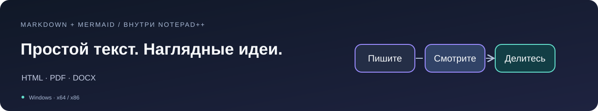
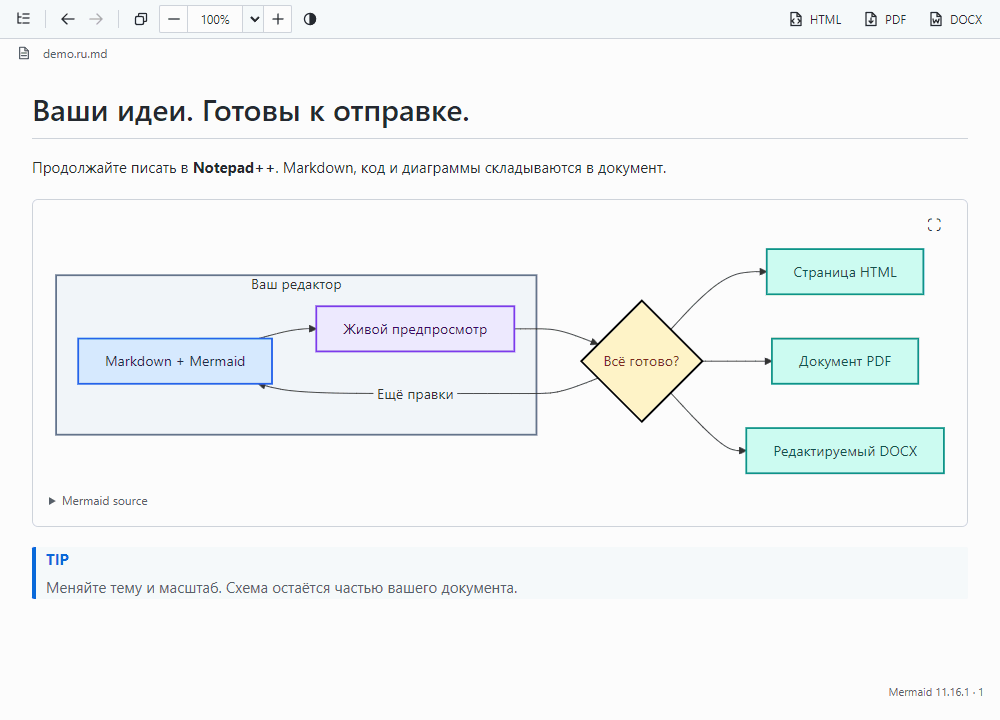
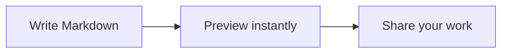

# Markdown with Mermaid

**Пишите в Notepad++. Смотрите результат. Делитесь документом.**

Живой предпросмотр Markdown, автономные диаграммы Mermaid, копирование с форматированием и экспорт HTML / PDF / DOCX — в привычном редакторе.



**[Скачать 1.4.1](https://github.com/rhyots/Markdown_with_Mermaid/releases/tag/v1.4.1)** · [Установка](#installation) · [Возможности](#features) · [Руководство](docs/USAGE.ru.md) · [English](README.md)

Windows · x64 и x86 · Mermaid в комплекте · Office и Pandoc не нужны

> **Версия 1.4.1** — скачайте ZIP для разрядности вашего Notepad++ и выполните шаги установки ниже. Плагин пока не включён в Plugins Admin.



*Настоящее отображение Preview, снятое в интеграционном стенде WebView2. Короткая последовательность показывает обновление содержимого, смену темы, масштаб и выделение. [Статичные снимки и описание съёмки](docs/screenshots/README.md).*

<!-- section:features -->
<a id="features"></a>
## Привычный редактор. Больше возможностей Markdown.

| Что вы хотите сделать | Что даёт плагин |
| --- | --- |
| **Видеть, что получается** | Живой предпросмотр в пристыковываемой панели: таблицы, задачи, подсветка кода, картинки и GitHub alerts. Видны и несохранённые правки. |
| **Открыть Markdown и сразу работать** | Preview автоматически появляется для `.md`-файлов. Автооткрытие и синхронизация с исходником включены при первом запуске. |
| **Не терять своё место** | Preview следует за исходником внутри длинных блоков и перенесённых строк. Двойной щелчок по Preview поднимает выбранную строку наверх обеих областей. |
| **Объяснить идею наглядно** | Встроенный **Mermaid 11.16.1** строит схемы без интернета, со светлой и тёмной темами, читаемыми подписями, стрелками и границами. |
| **Перемещаться по документации** | Содержание, ссылки на локальные Markdown-файлы и разделы, «Назад»/«Вперёд» и поиск помогают работать с большими документами. |
| **Передать готовый результат** | Копируйте с форматированием или экспортируйте в HTML, PDF и редактируемый DOCX — весь документ или выделенный фрагмент. |

Масштабируйте документ через **Ctrl+колёсико**: размер кнопок останется прежним. Изменяйте ширину или отстыковывайте панель — Notepad++ запомнит её расположение. Сохранённые настройки переживут обновление.

<!-- section:installation -->
<a id="installation"></a>
## Откройте первый предпросмотр

Нужны **Notepad++ 8.4.1 или новее** и [Microsoft Edge WebView2 Runtime](https://developer.microsoft.com/microsoft-edge/webview2/). Разрядность плагина должна совпадать с **Notepad++**, даже если сама Windows 64-разрядная.

1. Скачайте ZIP плагина **x64** или **x86** со страницы [Releases](https://github.com/rhyots/Markdown_with_Mermaid/releases). Выберите пакет плагина, а не архив исходников.
2. Сохраните документы и закройте Notepad++.
3. Создайте `plugins/Markdown_with_Mermaid` внутри папки установки Notepad++. Распакуйте туда **содержимое** ZIP, сохранив вложенные папки.
4. Запустите Notepad++ и откройте `.md`-файл. При первом использовании Preview появится автоматически; **Ctrl+Alt+M** показывает и скрывает панель.

```text
Notepad++/
└── plugins/
    └── Markdown_with_Mermaid/
        ├── Markdown_with_Mermaid.dll
        ├── assets/
        ├── x64/  (or x86/)
        │   └── WebView2Loader.dll
        ├── licenses/
        └── docs/
```

Для копирования в Program Files могут понадобиться права администратора. Для обычной работы они не нужны. Если плагин уже использовался, сохранённая настройка Auto-show остаётся в силе. [Помощь с установкой, обновление и удаление](docs/USAGE.ru.md).

<!-- section:example -->
<a id="example"></a>
## Попробуйте диаграмму

Сохраните этот пример как `.md`-файл и откройте в Notepad++:

````markdown
# A small idea, made visible


````

Измените подпись — схема обновится. Mermaid работает локально; для построения диаграммы интернет не нужен.

Откройте [полный пример](docs/screenshots/demo.ru.md) или посмотрите [блок-схемы, последовательности, ER-диаграммы, классы, диаграммы Ганта и круговые диаграммы](docs/Mermaid-examples.md).

<!-- section:export -->
<a id="export"></a>
## Из рабочей заметки — в готовый документ

| Действие | Что получится |
| --- | --- |
| **Copy** | Форматированный текст, списки, ссылки, таблицы и картинки для приложений с поддержкой HTML. Mermaid-диаграммы становятся изображениями. |
| **HTML** | Готовая страница со встроенными стилями и статичным Mermaid SVG. Изображения по ссылкам должны оставаться доступными. |
| **PDF** | Документ A4 в светлой теме, готовый к печати, вместе с диаграммами. Принтер не требуется. |
| **DOCX** | Редактируемые заголовки, абзацы, списки и таблицы; Mermaid-диаграммы встроены как изображения. Word для экспорта не нужен. |

**Нужна только часть?** Выделите её в Preview или исходнике и запустите экспорт. Чтобы выгрузить всё, снимите выделения в обеих областях. Экспорт учитывает несохранённые правки; PDF и DOCX используют светлую тему, не меняя ваш Preview.

Подробнее: [копирование и выделения](docs/USAGE.ru.md) · [PDF](docs/PDF-EXPORT.md) · [DOCX](docs/DOCX-EXPORT.md).

<!-- section:shortcuts -->
<a id="shortcuts"></a>
## Небольшие удобства на каждый день

| В Preview | Действие |
| --- | --- |
| **Ctrl+Alt+M** | Показать или скрыть панель из Notepad++. |
| **Ctrl+колёсико** / **Ctrl+0** | Изменить масштаб документа / вернуть исходный размер. |
| **Двойной щелчок по содержимому** | Перейти к нужной строке исходника, в том числе внутри длинного блока кода. |
| **Ctrl+F** | Найти текст в предпросмотре. |
| **Ctrl+C** / **Copy** | Скопировать выделение с форматированием или весь готовый документ, если ничего не выделено. |
| **Значок файла рядом с именем** | Скопировать имя файла обычным текстом, с кратким подтверждением. |
| **Кнопка темы** | Переключить светлую и тёмную тему Preview, подсветки кода и диаграмм. |

Когда фокус в редакторе, **Ctrl+C** по-прежнему копирует исходный Markdown. Синхронизация следует за редактором; двойной щелчок явно возвращает из Preview к исходнику.

<!-- section:compatibility -->
<a id="compatibility"></a>
## Совместимость

| Компонент | Поддержка |
| --- | --- |
| Notepad++ | **8.4.1+**, x64 и x86. Ручная функциональная приёмка на **8.9.8.1**; автоматическая проверка запуска/API/runtime минимальной версии на **8.4.1**. |
| Windows | Проверено на **Windows 10**. Windows 11 — целевая система, отдельно пока не проверена. |
| Отображение | Microsoft Edge WebView2 Runtime; Mermaid и остальные ресурсы предпросмотра включены в комплект. |
| Зависимости экспорта | Не нужны Office, LibreOffice, Pandoc, Node.js, .NET и отдельный Visual C++ Redistributable. |
| Распространение | ZIP-выпуски. Пакета ARM64 нет; DLL плагина не подписаны. Включение в публичный Plugins Admin ожидается. |

Локальные Markdown и Mermaid работают без интернета. Внешние картинки и ссылки могут обращаться к сети. Параметры страниц PDF/DOCX фиксированы; набор математических формул и внешние расширения компоновки Mermaid не включены. [Подробности проверок](docs/TESTING.md) · [Данные и приватность](docs/DATA-PRIVACY.md) · [Ограничения](docs/USAGE.ru.md).

<!-- section:documentation -->
<a id="documentation"></a>
## Узнайте больше

| Документ | О чём он |
| --- | --- |
| [Руководство](docs/USAGE.ru.md) | Навигация, копирование, экспорт, настройки и решение проблем. |
| [Примеры Mermaid](docs/Mermaid-examples.md) | Готовые примеры разных видов диаграмм. |
| [История изменений](CHANGELOG.md) | Что изменилось между выпусками. |
| [Сборка](docs/BUILDING.md) · [Проверки](docs/TESTING.md) | Как воспроизвести сборку и разобраться в проверенном поведении. |

<!-- section:support -->
<a id="support"></a>
## Помогите сделать плагин лучше

Нашли проблему? [Создайте issue](https://github.com/rhyots/Markdown_with_Mermaid/issues): укажите версию и разрядность Notepad++, версию Windows и небольшой пример Markdown. Для проблем отображения полезен скриншот.

Автор — [Artyom Nikiforov (rhyots)](https://github.com/rhyots) · [Лицензирование](docs/LICENSING.md).
