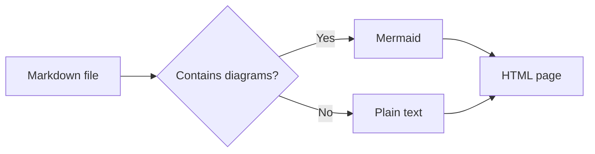
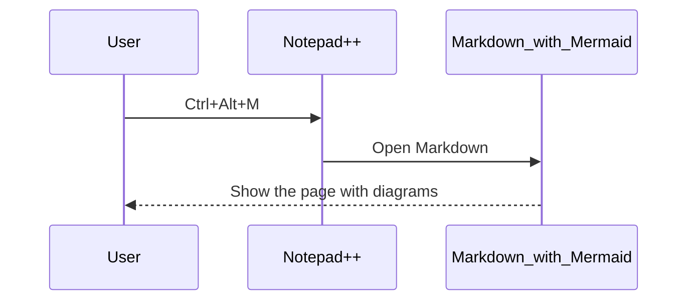
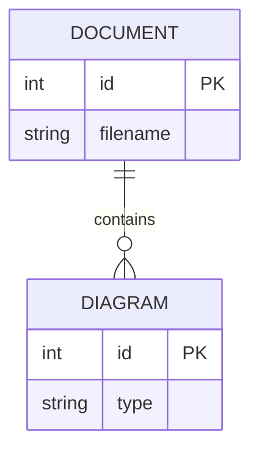
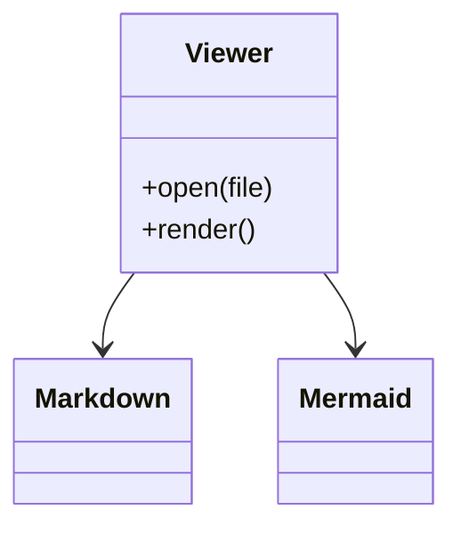
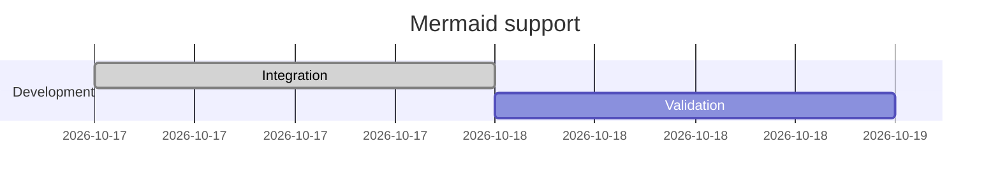
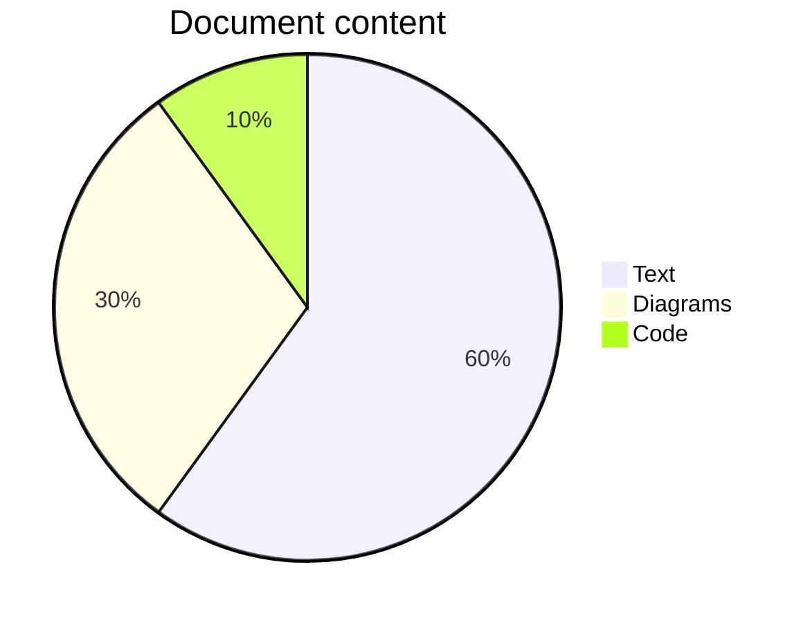

# Mermaid in Markdown_with_Mermaid

These diagrams render locally. Use the plugin's theme button to switch both
Preview and diagram colors between light and dark.

## Processing flow



## Sequence



## Entity relationships



## Classes



## Work plan



## Pie chart



## Text diagrams stay as text

```text
┌──────────┐     ┌──────────┐
│ Markdown │ ──► │   HTML   │
└──────────┘     └──────────┘
```
