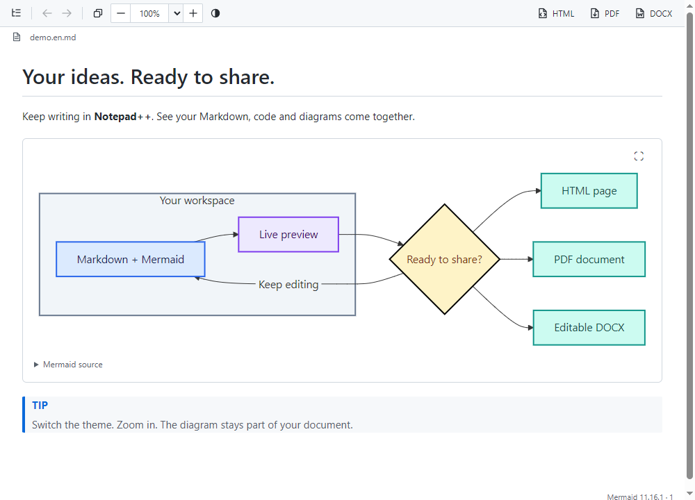
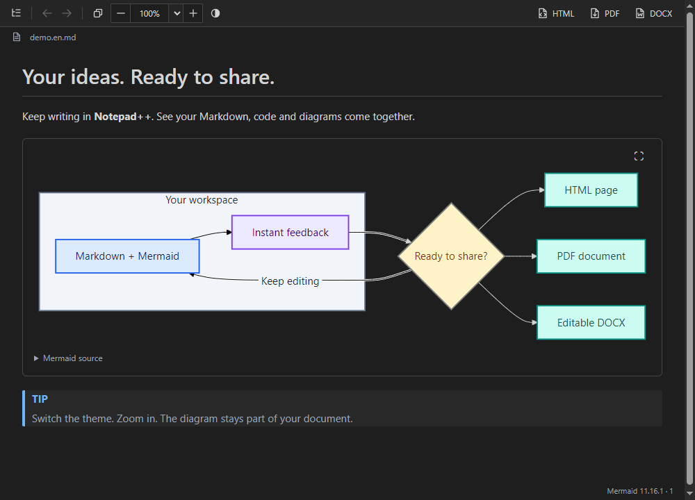
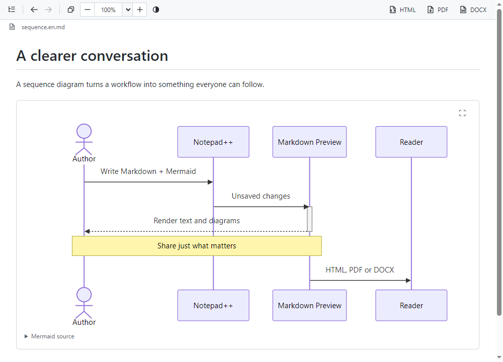

# Preview gallery

[English overview](../../README.md) · [Обзор на русском](../../README.ru.md)

The first two frames show a branching flowchart and a sequence diagram.
The remaining frames show dark mode, an updated label, document zoom and a
formatted selection. Both language versions use the same sequence and layout.

## Light preview

## Dark preview

## Sequence diagram

## Russian examples

[Light preview](preview-light.png) · [Dark preview](preview-dark.png) ·
[Sequence diagram](sequence.ru.png) · [Animated demo](preview-demo.ru.gif)

## Reuse these examples

Open [demo.en.md](demo.en.md) or [sequence.en.md](sequence.en.md) in Notepad++.
Russian equivalents: [demo.ru.md](demo.ru.md) and [sequence.ru.md](sequence.ru.md).
The examples are project-authored, with no remote images, personal paths or
private documents. The diagrams render offline.

## How the media were made

Captured on Windows 10 from the RC2 viewer, whose rendering assets are unchanged in 1.4.1 using WebView2
`CapturePreview`. The integration host supplies a modeled editor API; these are
actual Preview pixels, not full Notepad++ window recordings or mockups.
Product CSS, toolbar and diagram rendering are unchanged. The GIFs assemble
selected real captures with deliberate reading pauses; they are walkthroughs,
not real-time performance recordings. PNGs provide a motion-free alternative.

`banner.en.svg` and `banner.ru.svg` are original vector illustrations, not
screenshots. The earlier `preview-sample.*.md` files remain as small examples.
