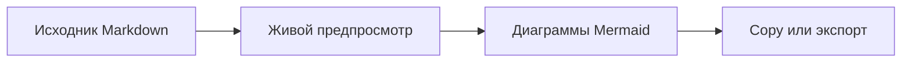

# Markdown with Mermaid

Просматривайте **Markdown**, стройте диаграммы без интернета и экспортируйте документ.

## Возможности

| Возможность | Готово |
| --- | --- |
| Автооткрытие для Markdown | Да |
| Синхронизация прокрутки с исходником | Да |
| Copy с форматированием и HTML / PDF / DOCX | Да |

## От исходника к документу

Выделите фрагмент для **Copy с форматированием** или экспортируйте весь документ.
