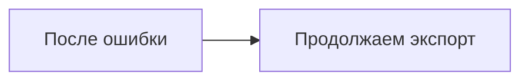

# DOCX export — проверка кириллицы

DOCX_TEXT_LAYER: Русский текст остаётся редактируемым.

**Жирный**, *курсив*, ~~зачёркнутый~~, `inline code`, [веб-ссылка](https://example.com),
[к таблице](#таблица-на-нескольких-страницах), [локальный MD](mermaid.md).

## Списки

- Первый пункт
  - Вложенный пункт
- Второй пункт

3. Третий пункт
4. Четвёртый пункт

- [x] Готово
- [ ] Не готово

> Цитата с **выделением**.

---

## Локальное изображение


## Ошибочная схема и продолжение

```mermaid
flowchart TD
  A[Unclosed
```



```javascript
const message = 'DOCX_CODE_LINE';
console.log(message);
```

## Таблица на нескольких страницах

| Number | Marker | Value |
| --- | --- | --- |
