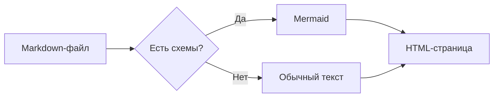
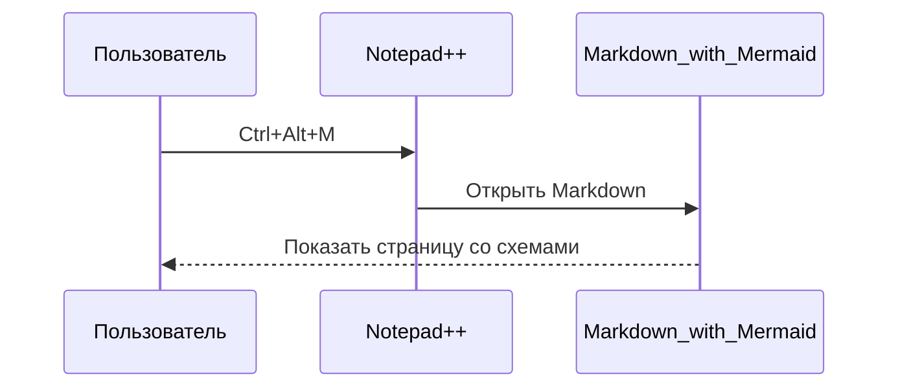
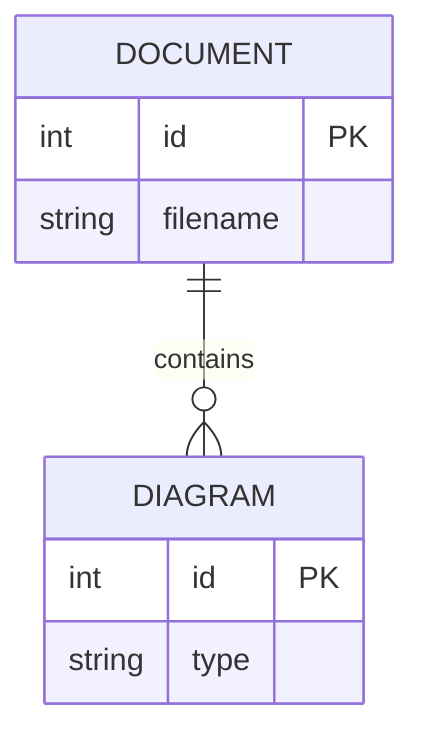
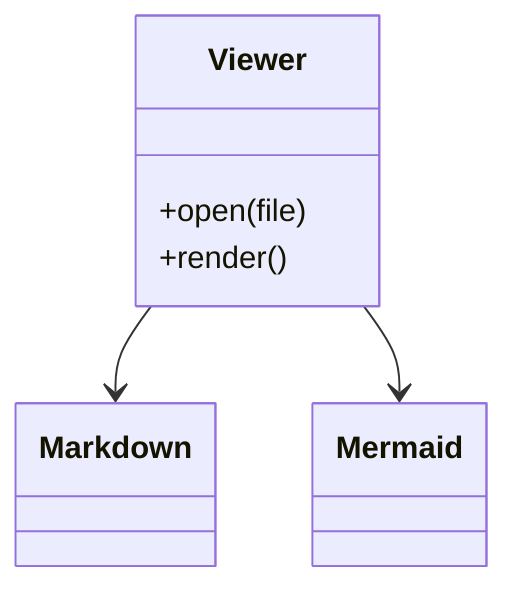
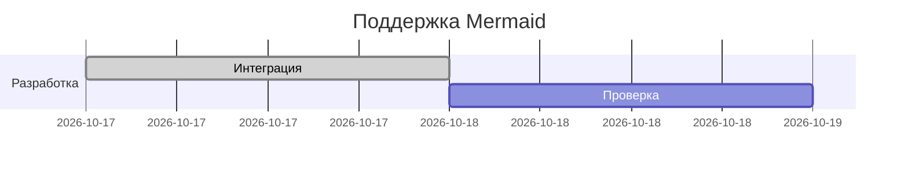
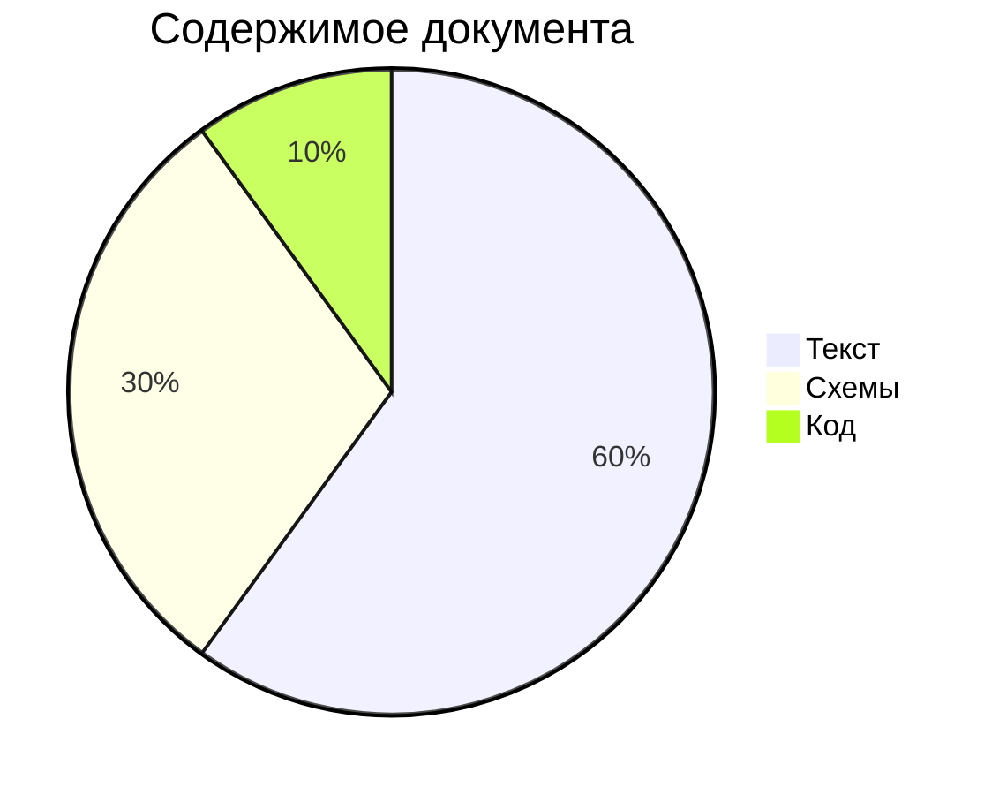

# Mermaid в Markdown_with_Mermaid

Схемы ниже строятся локально. Сменить тему вместе с цветами схем можно в меню плагина.

## Поток обработки



## Последовательность



## Связи таблиц



## Классы



## План работ



## Круговая диаграмма



## Псевдографика остаётся текстом

```text
┌──────────┐     ┌──────────┐
│ Markdown │ ──► │   HTML   │
└──────────┘     └──────────┘
```
