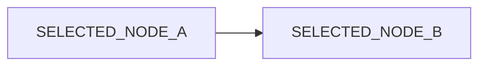

# OUTSIDE_BEFORE

OUTSIDE_PREFIX **жирный SELECTED_BOLD** OUTSIDE_SUFFIX

## SELECTED_SECTION

SELECTED_PARAGRAPH **жирный текст** и *курсив*, [SELECTED_LINK](https://example.com/selection). Кириллица и emoji 🧜. [Секция](#selected_section).

1. SELECTED_LIST_ONE
2. SELECTED_LIST_TWO

- [x] SELECTED_CHECKED
- [ ] SELECTED_UNCHECKED

| SELECTED_HEADER | Значение |
| --- | --- |
| SELECTED_CELL | **ячейка** |

# OUTSIDE_AFTER

OUTSIDE_TAIL
